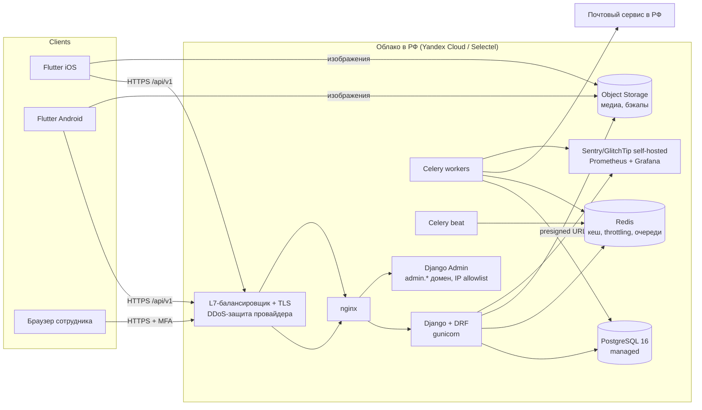
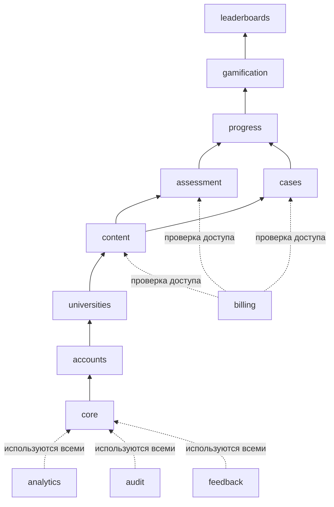

# 2. Архитектура

## 2.1. Общая схема



Один Django-проект обслуживает и API, и админку, но админка доступна только на отдельном поддомене с ограничением по IP (или через VPN) — один код, разные точки входа.

## 2.2. Почему модульный монолит

- Команда маленькая, нагрузка на MVP — сотни пользователей: микросервисы дали бы только операционные издержки.
- Транзакционная целостность (попытка теста → XP → достижение → рейтинг) проще в одной БД.
- Границы модулей задаются кодом (отдельные Django-приложения, правила зависимостей, сервисный слой), поэтому при росте модуль можно вынести (первые кандидаты — `analytics` и `leaderboards`).

## 2.3. Модули backend

```
backend/
├── config/                 # settings (base/dev/stage/prod), urls, celery, wsgi
├── apps/
│   ├── core/               # базовые модели (UUID, timestamps), ошибки API, пагинация, утилиты
│   ├── accounts/           # пользователи, коды подтверждения, сессии, согласия, удаление, запросы субъектов ПД
│   ├── universities/       # справочник вузов/факультетов/специальностей, образовательный профиль и его история
│   ├── content/            # дисциплины, темы, уроки и их ревизии, источники, медиа, МКБ-10, клинические рекомендации, редакционный процесс
│   ├── assessment/         # вопросы, варианты, тесты, попытки, ответы
│   ├── cases/              # клинические кейсы, шаги, выборы, попытки
│   ├── progress/           # прогресс по урокам, освоение тем/дисциплин
│   ├── gamification/       # XP-журнал, уровни, серии, достижения
│   ├── leaderboards/       # расчёт и выдача рейтингов, антинакрутка
│   ├── billing/            # тарифы, функции, подписки, транзакции, feature flags, проверка доступа
│   ├── analytics/          # приём событий, сессии, ежедневные агрегаты, панель метрик
│   ├── feedback/           # обратная связь и сообщения об ошибках в контенте
│   └── audit/              # журнал событий безопасности и действий в админке
└── tests/                  # e2e/API-сценарии поверх модулей
```

Внутри каждого модуля одинаковая раскладка:

```
apps/assessment/
├── models.py       # только данные и инварианты уровня строки
├── services.py     # команды: изменяют состояние (finish_attempt, submit_answer)
├── selectors.py    # запросы: читают состояние (get_quiz_for_user)
├── api/            # serializers.py, views.py, urls.py — тонкий слой без бизнес-логики
├── admin.py
├── tasks.py        # Celery-задачи
├── events.py       # доменные события модуля (dataclass'ы)
└── tests/
```

### Правила зависимостей



- Модуль пишет в чужие таблицы **только** через `services.py` владельца. Читать чужие модели через `selectors.py` разрешено.
- Нижние модули не знают о верхних. Например, `assessment` не вызывает `gamification` напрямую — после завершения попытки он публикует доменное событие `QuizAttemptFinished`, на которое подписан `gamification` (синхронный in-process диспетчер внутри той же транзакции через `transaction.on_commit` для побочных эффектов вроде пересчёта рейтинга).
- Проверка доступа к платному — единая функция `billing.selectors.has_feature(user, "cases.full")`; модули контента не знают про тарифы.
- Правила проверяются в CI через `import-linter`.

## 2.4. Соглашения API

| Аспект | Решение |
|--------|---------|
| Версионирование | в пути: `/api/v1/…`. Несовместимые изменения — только в `/api/v2/`; v1 поддерживается, пока доля клиентов на старых версиях > 5 % |
| Контракт | OpenAPI 3 через `drf-spectacular`; схема в CI сравнивается с предыдущей (`oasdiff`) — ломающее изменение в v1 валит сборку |
| Клиент | Dart-клиент генерируется из схемы (`openapi-generator`, dio) |
| Формат | JSON, `snake_case`, даты ISO 8601 UTC, идентификаторы — UUID (кроме справочников) |
| Ошибки | `{"error": {"code": "invalid_code", "message": "…", "fields": {"email": ["…"]}}}`, стабильные машинные коды |
| Пагинация | cursor-based для лент и рейтингов, limit/offset для небольших справочников |
| Идемпотентность | заголовок `Idempotency-Key` для `POST` завершения попыток и отправки событий |
| Кеш | `ETag`/`If-None-Match` для каталога и справочников |
| Конфигурация клиента | `GET /api/v1/app/config`: feature flags, минимальная версия приложения, версии юридических документов, `monetization_enabled` |
| Лимиты | DRF throttling в Redis: анонимные, аутентифицированные и отдельные жёсткие для auth-эндпоинтов |

### Основные эндпоинты v1

```
POST   /auth/register                 POST /auth/verify-email        POST /auth/resend-code
POST   /auth/login                    POST /auth/refresh             POST /auth/logout
POST   /auth/password/forgot          POST /auth/password/reset      POST /auth/password/change
GET    /auth/sessions                 DELETE /auth/sessions/{id}     DELETE /auth/sessions (кроме текущей)

GET    /me                            PATCH /me                      GET  /me/consents
POST   /me/deletion-code              POST /me/delete {code}         POST /me/export
GET    /me/education                  PUT  /me/education             GET  /me/education/history

GET    /universities?search=          GET  /universities/{id}/faculties   GET /specialties
POST   /universities/requests

GET    /disciplines                   GET  /disciplines/{slug}       GET  /topics/{id}
GET    /lessons/{id}                  POST /lessons/{id}/complete
GET    /icd10?search=                 GET  /icd10/{code}
GET    /guidelines?search=            GET  /guidelines/{id}
GET    /search?q=

GET    /quizzes/{id}                  POST /quizzes/{id}/attempts    (создать: training|topic)
POST   /attempts/{id}/answers         POST /attempts/{id}/finish     GET  /attempts/{id}/review
GET    /cases                         POST /cases/{id}/attempts      POST /case-attempts/{id}/choices
GET    /case-attempts/{id}/review

GET    /me/progress                   GET  /me/progress/disciplines/{id}   GET /me/activity?period=week
GET    /me/achievements               GET  /me/xp-history

GET    /leaderboards/users?scope=global|university&period=week
GET    /leaderboards/universities?period=month
PUT    /me/leaderboard-participation

POST   /feedback                      POST /events (пакет аналитических событий)
GET    /app/config
```

## 2.5. Инфраструктура и окружения

| Окружение | Назначение | Состав |
|-----------|-----------|--------|
| local | разработка | `docker compose`: postgres, redis, minio, mailpit, api, worker |
| stage | тестирование, TestFlight / RuStore-тест | 1 VM (Docker Compose) + managed PostgreSQL + managed Redis + Object Storage |
| prod | пользователи | то же, отдельный аккаунт/каталог облака; 2 инстанса API за балансировщиком при росте |

- **Хостинг:** провайдер с дата-центрами в РФ — Yandex Cloud или Selectel (у обоих есть сегменты, аттестованные под 152-ФЗ). Все ПД, бэкапы и логи с ПД остаются в РФ.
- **Почта:** российский транзакционный сервис (например Yandex Cloud Postbox или Unisender Go) с SPF/DKIM/DMARC.
- **Секреты:** только переменные окружения из секрет-хранилища провайдера (Lockbox / Secrets Manager); в репозитории — только `.env.example` без значений. `gitleaks` в pre-commit и CI.
- **CI/CD (GitHub Actions или GitLab CI):** lint (ruff, mypy, flutter analyze) → тесты → `import-linter` → `oasdiff` → `pip-audit`/`osv-scanner` → сборка образа → деплой на stage по merge в `main`, на prod — по тегу с ручным подтверждением. Миграции — отдельный шаг перед переключением трафика, только обратно-совместимые (expand → migrate → contract).
- **Наблюдаемость:** self-hosted Sentry/GlitchTip в РФ (с фильтрацией ПД до отправки), Prometheus + Grafana, структурированные JSON-логи без ПД и токенов.
- **Масштабирование:** API stateless → горизонтально; тяжёлые агрегаты — в Celery и ночные материализованные таблицы; таблицы событий партиционируются по месяцам; при росте — read-replica для аналитики.

## 2.6. Мобильное приложение (Flutter)

| Аспект | Решение |
|--------|---------|
| Состояние | Riverpod (code generation) |
| Навигация | go_router с `StatefulShellRoute` для 5 вкладок, deep links для кода подтверждения не нужны (код вводится вручную) |
| Сеть | dio + интерцептор авторизации (одиночный refresh при 401, очередь запросов на время обновления) |
| Модели | freezed + json_serializable, сгенерированный API-клиент |
| Хранение | `flutter_secure_storage` (Keychain / Android Keystore) — только refresh-токен; access-токен — в памяти; кеш каталога и уроков — drift (SQLite) |
| Аналитика | собственный батчер событий → `POST /api/v1/events` (без сторонних SDK, передающих ПД за рубеж) |
| Ошибки | Sentry SDK, направленный на self-hosted сервер, с вычищением ПД |
| Флейворы | dev / stage / prod (разные bundle id, API host, иконки) |
| Минимальные ОС | iOS 15+, Android 8.0 (API 26)+ |
| Магазины | App Store (StoreKit 2 — позже), RuStore (Pay SDK — позже); без зависимости от Google Play Services |

Структура — по фичам:

```
mobile/lib/
├── app/            # router, theme (токены светлой/тёмной темы), DI
├── core/           # api-клиент, auth-хранилище, ошибки, аналитика, ui-kit (AuraCard, DotNumber, PillButton…)
└── features/
    ├── auth/  onboarding/  home/  catalog/  lesson/  references/
    ├── quiz/  cases/  progress/  leaderboard/  profile/  settings/  feedback/
    └── <feature>/{data, domain, presentation}
```
