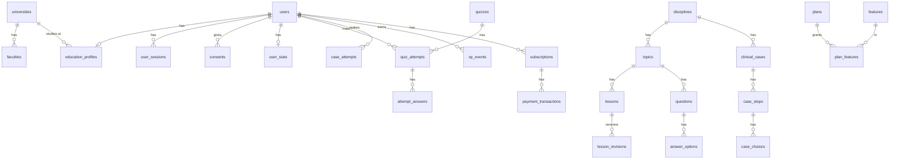

# 3. Схема базы данных (PostgreSQL 16)

Общие правила:

- Первичные ключи пользовательских сущностей — `uuid` (не раскрывают количество записей); справочники и контент — `bigint identity`.
- Все таблицы имеют `created_at`, `updated_at` (`timestamptz`, UTC).
- Email приводится к нижнему регистру при сохранении; уникальный индекс + CHECK `email = lower(email)` (без расширения citext).
- Опубликованный контент **неизменяем**: правка создаёт новую ревизию/версию, попытки ссылаются на конкретную версию — разбор старой попытки всегда показывает то, что видел пользователь.
- Журналы (`xp_events`, `analytics_events`, `security_events`) — только вставка; у роли приложения нет `UPDATE/DELETE` на `security_events`.
- Таблицы событий партиционируются по месяцам (`pg_partman`) с момента, когда превысят ~10 млн строк; схема сразу совместима.
- Перечисления — `varchar` + `CHECK` (проще мигрировать, чем PostgreSQL `enum`).

## 3.1. Обзор связей

## 3.2. accounts

**users**
| Поле | Тип | Примечание |
|------|-----|-----------|
| id | uuid PK | |
| email | varchar(254) UNIQUE, CHECK lower | |
| email_verified_at | timestamptz NULL | подтверждённый аккаунт ⇔ NOT NULL |
| password | varchar(255) | хеш Argon2id в формате Django |
| display_name | varchar(32) UNIQUE | никнейм; единственное, что видно в рейтингах |
| first_name | varchar(64) NULL | необязательно, только для обращения в приложении |
| is_active, is_staff, is_superuser | bool | |
| leaderboard_opt_in | bool DEFAULT false | добровольное участие в рейтингах |
| founder_number | int NULL UNIQUE | порядковый номер среди первых 100 подтверждённых |
| trust_status | varchar CHECK (`ok`,`suspicious`,`blocked`) | антифрод |
| last_login_at, deleted_at | timestamptz NULL | `deleted_at` — момент обезличивания |

**one_time_codes** — коды подтверждения email, сброса пароля, смены email, удаления аккаунта
`id uuid, user_id FK, purpose CHECK(verify_email, reset_password, change_email, delete_account), code_hash, target_email citext NULL, expires_at, attempts smallint, consumed_at NULL`.
Индекс `(user_id, purpose) WHERE consumed_at IS NULL`.

**user_sessions** — одна строка = одно устройство
`id uuid (sid), user_id FK, refresh_token_hash char(64) UNIQUE, previous_refresh_hash char(64) (индекс; для reuse detection), family_id uuid, device_name varchar(64), platform CHECK(ios, android), app_version, ip_last inet, created_at, last_used_at, expires_at (скользящий, 30 дней), absolute_expires_at (90 дней от входа), revoked_at NULL, revoke_reason`.

**consents**
`id, user_id FK, document CHECK(pd_processing, terms, privacy_policy, marketing), document_version varchar(16), accepted_at, ip inet, withdrawn_at NULL`.

**data_subject_requests**
`id, user_id NULL, contact_email_hash, kind CHECK(access, export, rectify, delete, withdraw_consent), status, received_at, due_at, completed_at, handled_by FK users NULL, note`.

## 3.3. universities

**universities** `id, name, short_name, city, region, is_active, source, created_by_request_id NULL`
**faculties** `id, university_id FK, name, is_active`
**specialties** `id, code varchar(16) (напр. 31.05.01), name, level CHECK(specialitet, residency, postgraduate)`
**university_email_domains** `id, university_id FK, domain UNIQUE` — задел для подтверждения по вузовской почте
**university_requests** `id, user_id FK, name, city, status CHECK(new, approved, rejected, merged), resolved_university_id NULL`

**education_profiles** (1:1 с users)
| Поле | Тип | Примечание |
|------|-----|-----------|
| user_id | uuid PK FK | |
| status | varchar CHECK(student, resident, postgraduate, doctor) | |
| university_id, faculty_id, specialty_id | FK NULL | |
| course | smallint NULL CHECK 1..6 | для студентов |
| study_year | smallint NULL CHECK 1..5 | год ординатуры/аспирантуры |
| graduation_year | smallint NULL | |
| verification_status | varchar CHECK(unverified, pending, verified, rejected) DEFAULT 'unverified' | |
| verification_method | varchar NULL CHECK(edu_email, document, manual) | |
| verified_at | timestamptz NULL | |

**education_profile_history** `id, user_id FK, snapshot jsonb, changed_at` — запись при каждом изменении.

## 3.4. content

**sources** — откуда материал и на каком праве он используется
`id, title, kind CHECK(clinical_guideline, textbook, article, own, other), authors, publisher, year, url, license CHECK(own, licensed, cc_by, cc_by_sa, public_domain, citation, permission), rights_document_key NULL (S3), rights_expires_at NULL, notes`.

**disciplines** `id, slug UNIQUE, title, description, icon, palette_token, sort_order, status, is_premium bool DEFAULT false`
**topics** `id, discipline_id FK, slug, title, sort_order, status, is_premium` — UNIQUE `(discipline_id, slug)`

**lessons** `id, topic_id FK, slug, sort_order, published_revision_id FK NULL, is_premium`
**lesson_revisions**
| Поле | Тип | Примечание |
|------|-----|-----------|
| id | bigint PK | |
| lesson_id | FK | |
| version | int | UNIQUE `(lesson_id, version)` |
| title | varchar | |
| body | jsonb | массив блоков: `heading`, `paragraph`, `list`, `table`, `image`, `callout`, `icd_ref`, `guideline_ref` |
| estimated_minutes | smallint | |
| status | varchar CHECK(draft, in_review, changes_requested, approved, published, archived) | |
| author_id, reviewer_id, publisher_id | FK users | рецензент ≠ автор (CHECK) |
| reviewed_at, published_at | timestamptz | |
| change_summary | text | что исправлено и почему |

Частичный уникальный индекс: не более одной ревизии `published` на урок.

**content_reviews** — история рецензирования любой единицы контента
`id, content_type (lesson_revision | question | clinical_case | guideline_version), object_id, reviewer_id, decision CHECK(approve, request_changes, reject), comment, created_at`.

**content_sources** `content_type, object_id, source_id FK, locator (страница/раздел)` — связь контента с источниками.

**icd10_codes** `code varchar(8) PK, parent_code NULL, title, chapter, block, is_leaf, nsi_version` — импорт из НСИ Минздрава, версия импорта сохраняется.

**clinical_guidelines** `id, rubricator_id (ID на cr.minzdrav.gov.ru), title, icd_codes text[], age_group CHECK(adults, children, all), developer, status CHECK(active, under_revision, superseded, withdrawn), current_version_id FK NULL`
**guideline_versions** `id, guideline_id FK, version_label, approved_at date, effective_from date, revision_due date NULL, summary jsonb, source_url, file_key NULL, checked_by FK users, checked_at, superseded_by_id NULL`.

**media_assets** `id, s3_key, mime, size_bytes, sha256, width, height, alt_text, source_id FK, uploaded_by, status`.

## 3.5. assessment

**questions**
`id, topic_id FK, kind CHECK(single, multiple), stem jsonb, explanation text, difficulty smallint CHECK 1..3, version int, previous_version_id FK NULL, status (как у ревизий), author_id, reviewer_id, published_at, is_premium`.
Правка опубликованного вопроса = новая строка с `previous_version_id`, старая → `archived`.

**answer_options** `id, question_id FK, text, is_correct bool, explanation text, sort_order` — разбор хранится для каждого варианта.

**quizzes** `id, discipline_id FK, topic_id FK NULL, title, mode CHECK(fixed, random), question_count, time_limit_sec NULL, pass_threshold numeric(3,2), is_premium, status`
**quiz_questions** `quiz_id, question_id, sort_order` — для `fixed`.

**quiz_attempts**
`id uuid, user_id FK, quiz_id FK NULL (NULL для тренировки), discipline_id FK, mode CHECK(topic, training, mistakes), status CHECK(in_progress, finished, abandoned), started_at, finished_at, correct_count, total_count, score numeric(5,2), xp_awarded int, flagged bool DEFAULT false`.
Индексы: `(user_id, finished_at DESC)`, `(quiz_id, user_id)`.

**attempt_answers**
`id, attempt_id FK, question_id FK (конкретная версия), selected_option_ids bigint[], is_correct, time_spent_ms int, answered_at`. UNIQUE `(attempt_id, question_id)`.

## 3.6. cases

**clinical_cases** `id, discipline_id FK, title, summary, difficulty, version, previous_version_id NULL, status, is_synthetic bool NOT NULL CHECK (is_synthetic), synthetic_attested_by FK users, author_id, reviewer_id, published_at, is_premium`
**case_steps** `id, case_id FK, sort_order, kind CHECK(narrative, decision, question), content jsonb` — анамнез, осмотр, результаты обследований (синтетические)
**case_choices** `id, step_id FK, text, quality CHECK(optimal, acceptable, wrong, dangerous), score_delta smallint, feedback text, next_step_id FK NULL`
**case_attempts** `id uuid, user_id FK, case_id FK, status, started_at, finished_at, score, path bigint[] (id выбранных вариантов), xp_awarded`.

## 3.7. progress и gamification

**lesson_progress** `user_id, lesson_id, revision_id, completed_at` — PK `(user_id, lesson_id)`
**topic_mastery** `user_id, topic_id, answered, correct, mastery numeric(4,3), updated_at` — PK `(user_id, topic_id)`; освоение = взвешенная доля верных за последние N ответов.

**xp_events** — XP-журнал, источник истины
| Поле | Тип | Примечание |
|------|-----|-----------|
| id | bigint PK | |
| user_id | uuid FK | |
| amount | int | может быть отрицательным (сторно при антифроде) |
| reason | varchar | `lesson_completed`, `quiz_correct`, `quiz_bonus`, `case_completed`, `streak`, `achievement`, `reversal` |
| source_type, source_id | varchar, varchar | |
| university_id | FK NULL | снимок вуза на момент начисления — рейтинг вуза не «переезжает» при смене вуза |
| idempotency_key | varchar UNIQUE | исключает двойное начисление |
| created_at | timestamptz | индекс `(created_at)`, `(user_id, created_at)` |

**user_stats** (денормализация для быстрого чтения) `user_id PK, total_xp, level, current_streak, longest_streak, last_active_date, quizzes_finished, cases_finished, lessons_completed`.

**achievements** `id, code UNIQUE, title, description, icon, criteria jsonb, xp_reward, is_hidden, is_active`
**user_achievements** `user_id, achievement_id, earned_at` — PK `(user_id, achievement_id)`.

**leaderboard_snapshots** `id, board CHECK(users_global, users_university, universities), period CHECK(week, month, all_time), period_start date, university_id NULL, entity_id, rank, score, participants, computed_at` — история рейтингов; «живой» рейтинг держится в Redis sorted sets.

## 3.8. billing

**plans** `id, code UNIQUE (free, premium), title, is_active`
**features** `id, key UNIQUE (напр. catalog.full, quiz.advanced, cases.full, analytics.advanced), description`
**plan_features** `plan_id, feature_id, limit_value int NULL` — напр. `cases.monthly_limit = 5` для free
**store_products** `id, plan_id, store CHECK(app_store, rustore), product_id, period CHECK(month, year), trial_days smallint, is_active`
**subscriptions** `id uuid, user_id, plan_id, store_product_id NULL, store, status CHECK(trial, active, grace, expired, canceled, refunded), started_at, current_period_end, original_transaction_id, auto_renew, offer_code NULL`
**payment_transactions** `id uuid, subscription_id, user_id, store, store_transaction_id UNIQUE, amount numeric(10,2), currency, status, verified_at, raw_payload jsonb` — заполняется только после подключения магазинов
**entitlement_grants** `id, user_id, plan_id NULL, feature_id NULL, reason CHECK(founder, staff, promo, compensation), starts_at, expires_at NULL, granted_by`
**feature_flags** `key PK, enabled bool, description, rollout_percent smallint, rules jsonb (платформы, min_app_version, группы), updated_by, updated_at`
**system_milestones** `key PK (напр. confirmed_users_100), reached_at, value, notified_at` — фиксирует достижение порога 100.

## 3.9. analytics, feedback, audit

**analytics_events** `id bigint, event varchar(64), user_id uuid NULL, install_id uuid, session_id uuid, occurred_at, received_at, platform, app_version, props jsonb` — индекс `(event, occurred_at)`, BRIN по `occurred_at`. Ключи `props` проверяются по белому списку на сервере.
**app_sessions** `id uuid, user_id NULL, install_id, platform, started_at, last_seen_at, ended_at, duration_sec`
**daily_user_activity** `date, user_id, sessions, active_seconds, quizzes, lessons` — PK `(date, user_id)`; основа DAU/MAU/retention
**daily_metrics** `date PK, registered, confirmed, dau, wau, mau, quizzes_finished, cases_finished, avg_session_sec, median_session_sec, …` — считается ночью

**feedback** `id, user_id NULL, kind CHECK(bug, content_error, idea, rating), content_type NULL, object_id NULL, screen, rating smallint NULL, text, app_version, platform, status CHECK(new, in_progress, resolved, rejected), handled_by, resolved_at`

**security_events** `id bigint, occurred_at, actor_user_id NULL, subject_user_id NULL, event varchar, outcome CHECK(success, failure), ip inet, user_agent varchar(256), details jsonb` — без паролей, кодов и токенов.
**admin_audit_log** `id, occurred_at, staff_user_id, action, model, object_id, diff jsonb, ip`.
