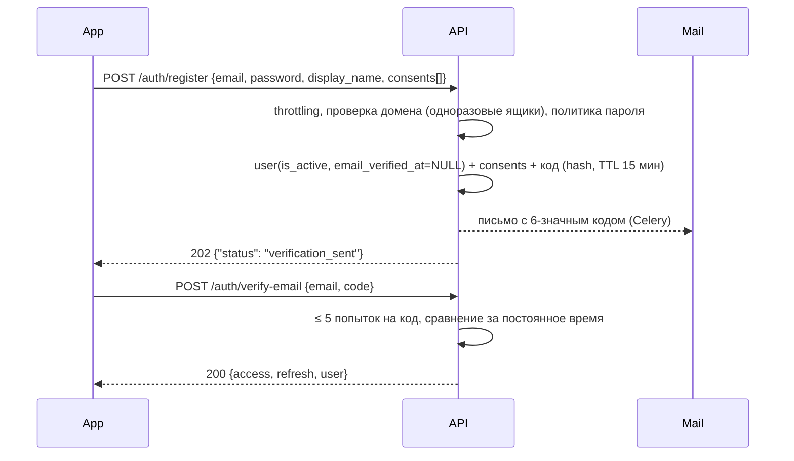

# 4. Авторизация и информационная безопасность

## 4.1. Регистрация и подтверждение email

- Ответ на регистрацию одинаков, существует email или нет; если существует — владельцу уходит письмо «кто-то пытался зарегистрироваться» (защита от перебора адресов).
- Без подтверждения email можно войти и учиться, но **прогресс не участвует в рейтингах, не учитывается в счётчике 100 пользователей и не получает номер основателя**. Неподтверждённые аккаунты старше 7 дней обезличиваются (так же, как при удалении, см. 4.7).
- Повторная отправка кода — не чаще 1 раза в 60 с и 5 раз в сутки.
- Согласие на обработку ПД — **отдельный документ и отдельный чекбокс** (требование 152-ФЗ к отдельному согласию), версия документа фиксируется в `consents`.

## 4.2. Пароли

- Хеширование **Argon2id** (`argon2-cffi`, `django.contrib.auth.hashers.Argon2PasswordHasher` первым в `PASSWORD_HASHERS`); параметры подбираются так, чтобы хеш считался ~250–400 мс на prod-сервере (стартовые: memory 64 MiB, time 3, parallelism 2). При входе хеш с устаревшими параметрами пересчитывается автоматически.
- Политика: ≥ 10 символов, не из списка распространённых паролей, не похож на email/никнейм; без требований «заглавная + цифра» (NIST SP 800-63B).
- Смена/сброс пароля → отзыв всех остальных сессий + письмо-уведомление.

## 4.3. Токены и сессии

| Токен | Формат | Срок | Где хранится на клиенте |
|-------|--------|------|------------------------|
| Access | JWT (HS256, ключ из секрет-хранилища, `kid` для ротации), claims: `sub`, `sid`, `exp`, `iat`, `scope` | 15 минут | только в памяти |
| Refresh | случайные 256 бит (base64url), в БД — SHA-256 | 30 дней скользящих, абсолютный максимум 90 дней | Keychain / Android Keystore (`flutter_secure_storage`, `first_unlock_this_device`) |

- **Ротация:** каждый `POST /auth/refresh` выдаёт новую пару и инвалидирует старый refresh. Сессия устройства — одна строка `user_sessions`, её `id` = `sid` в access и не меняется при ротации; хеш предыдущего refresh хранится в `previous_refresh_hash`. Повторное предъявление предыдущего refresh (`reuse detection`) → отзыв сессии (возможная кража) + событие безопасности + письмо владельцу. Более старые refresh просто недействительны.
- **Отзыв сессии** мгновенный: `sid` попадает в denylist в Redis до истечения access-токена; middleware проверяет его на каждый запрос (O(1)).
- Пользователь видит список устройств (платформа, модель, последняя активность, город по IP не определяем) и может завершить любую сессию или все, кроме текущей.
- Лимит — 10 активных сессий на пользователя, самая старая вытесняется.

## 4.4. Восстановление пароля и смена email

- Сброс — тот же механизм 6-значного кода (`purpose = reset_password`), одинаковый ответ для существующих и несуществующих адресов.
- Смена email: код на **новый** адрес + уведомление на **старый** с возможностью отменить в течение 72 часов. *Не реализовано на этапе 3 — до этого смену email выполняет поддержка по запросу.*

## 4.5. Администраторы: RBAC и MFA

- Роли — Django Groups с наборами permissions: `content_author`, `medical_reviewer`, `chief_editor`, `support`, `analyst` (описаны в `apps/accounts/roles.py`, синхронизируются при `migrate`); `superadmin` — флаг `is_superuser`. Принцип наименьших привилегий; аналитик не видит email пользователей; журналы безопасности и действий в админке видит только superadmin.
- Бизнес-правила процесса закреплены в коде, а не только в правах: рецензент не может одобрить собственную ревизию; опубликовать может только `chief_editor`.
- **MFA обязательна** для любого `is_staff` (`django-otp` TOTP + 10 одноразовых резервных кодов); без второго фактора админка не открывается. Подключение — `manage.py enroll_totp <email>` (QR-код в терминале), замена при утере телефона — `--reset`. Неверный код пишется в журнал (`admin.mfa`). Только в локальной разработке (`config.settings.dev`) второй фактор выключен по умолчанию (`ADMIN_REQUIRE_OTP`), prod с выключенным не стартует.
- Админка — на поддомене `admin.…`, доступ только из allowlist IP / VPN (настраивается на reverse proxy на этапе 8), отдельный короткий таймаут сессии (30 мин бездействия), `SESSION_COOKIE_SECURE`, `HttpOnly`, `SameSite=Strict`, CSRF.
- Все действия в админке пишутся в `admin_audit_log` (копия Django `LogEntry` в append-only таблицу: какие поля изменены, без значений).
- Выдача ролей — только `superadmin`, событие в журнале безопасности и уведомление остальным суперадминам.

## 4.6. 152-ФЗ и минимизация данных

| Требование | Решение |
|-----------|---------|
| Статус оператора ПД | юрлицо/ИП подаёт **уведомление в Роскомнадзор** до начала обработки |
| Локализация (ч. 5 ст. 18) | БД, бэкапы, файлы, логи и почтовый сервис — в РФ. Сторонние SDK, передающие ПД за рубеж (Firebase Analytics/Crashlytics и т. п.), не используются |
| Минимизация | собираем: email, никнейм, имя (необязательно), образовательный профиль, технические данные сессий. **Не собираем:** телефон, дату рождения, фото (аватары — из встроенного набора), данные о здоровье, геолокацию |
| Согласие | отдельный документ, версионирование, отзыв согласия из настроек = удаление аккаунта |
| Документы | Политика обработки ПД (публично доступна), Пользовательское соглашение, Согласие на обработку ПД; ссылки — на экране регистрации и в настройках |
| Уровень защищенности | оценочно **УЗ-4** (общие ПД, < 100 тыс. субъектов, угрозы 3-го типа) — подтверждается моделью угроз; выполняются соответствующие меры по Приказу ФСТЭК № 21 и ПП РФ № 1119 |
| Сроки ответов субъектам | сведения об обработке — в течение 10 рабочих дней (с возможным продлением на 5), уничтожение после отзыва согласия — до 30 дней; срок контролируется полем `due_at` |
| Ответственный | назначается ответственный за организацию обработки ПД, ведётся журнал инцидентов; об утечке — уведомление РКН в течение 24 часов (первичное) и 72 часов (по результатам расследования) |
| Данные пациентов | **не обрабатываются вовсе.** Кейсы синтетические (`is_synthetic` + аттестация рецензентом). В форме обратной связи предупреждение «не указывайте данные реальных пациентов» |

Отдельно: приложение — учебное и не является медицинским изделием (не используется для диагностики и лечения). Дисклеймер — в онбординге, в каждом кейсе и в разделе КР.

## 4.7. Удаление аккаунта и запросы субъектов ПД

**Удаление (требование App Store — доступно внутри приложения):**

1. Пользователь подтверждает удаление кодом из письма: `POST /me/deletion-code` → `POST /me/delete {code}`.
2. Сразу: все сессии отозваны, `is_active = false`, аккаунт исключён из рейтингов.
3. В той же транзакции — **обезличивание**: email → `deleted+<uuid>@invalid`, `display_name` → `deleted_<короткий id>`, `first_name` и образовательный профиль удаляются, `consents` фиксируют отзыв, `user_sessions` и `one_time_codes` удаляются.
4. Учебная статистика и XP-журнал остаются привязанными к обезличенному UUID (для агрегатов аналитики и честности исторических рейтингов вузов); `analytics_events.user_id` очищается Celery-задачей.
5. В течение 30 дней ПД исчезают и из бэкапов за счёт ротации (срок хранения бэкапов ≤ 30 дней).

Строки пользователей не удаляются физически (XP-журнал и аудит — append-only и ссылаются на UUID): и самообслуживание, и действие «Обезличить» в админке, и очистка неподтверждённых выполняют одно и то же обезличивание. Модули выше `accounts` удаляют свои ПД по сигналу `account_deleted`.

**Выгрузка данных:** `POST /me/export` (не чаще раза в сутки) → Celery собирает JSON (профиль, согласия, устройства, образовательный профиль; прогресс и попытки добавятся с этапом 5 через сигнал `export_requested`) → JSON уходит **вложением в письмо** на подтверждённый адрес. Вложение вместо ссылки на S3: тот же канал, что и коды сброса пароля, и не нужно хранить файл с ПД и чистить бакет. Факт выгрузки — в `pd_requests`.

## 4.8. Защита API

- TLS 1.2+ (предпочтительно 1.3), HSTS; HTTP закрыт.
- Аутентификация по умолчанию для всех эндпоинтов (`DEFAULT_PERMISSION_CLASSES = IsAuthenticated`), публичные — явный allowlist.
- **Авторизация на уровне объекта:** каждая выборка попыток/прогресса фильтруется по `request.user` в selector'е (защита от IDOR); тесты на «чужой UUID → 404».
- Ответы теста не отдаются клиенту до завершения попытки (поле `is_correct` и разборы — только в `/review`); время ответа фиксирует сервер.
- Валидация входа через сериализаторы, ORM без сырого SQL, лимиты размера тела запроса, CORS закрыт (мобильный клиент его не требует).
- Заголовки безопасности для админки: CSP, `X-Frame-Options: DENY`, `Referrer-Policy`.
- Загрузка файлов только сотрудниками, проверка MIME и размера, хранение в приватном бакете, выдача через presigned URL.

### Лимиты запросов (Redis)

| Эндпоинт | Лимит |
|----------|-------|
| `/auth/login` | 5/мин на IP+email, 20/час на email; после 10 неудач подряд — задержка 15 мин и письмо владельцу |
| `/auth/register` | 3/час на IP, 20/сутки на подсеть /24 |
| `/auth/verify-email`, `/auth/password/reset` | 5 попыток на код, 10/час на IP |
| аутентифицированные запросы | 120/мин на пользователя |
| `/events` | 30 пакетов/мин, ≤ 100 событий в пакете |

## 4.9. Защита от ботов и накрутки рейтингов

| Угроза | Мера |
|--------|------|
| Массовые регистрации | лимиты выше, блок-лист одноразовых почтовых доменов, обязательное подтверждение email, капча (Yandex SmartCaptcha) включается флагом при аномальном росте регистраций |
| Фарм XP повторами | XP за тест — только за первое прохождение и за **прирост** лучшего результата; суточный лимит 500 XP; повторные уроки XP не дают |
| Автоматические ответы | серверный учёт времени на вопрос; ответы < 1,5 с подряд, 100 % при подозрительной скорости → попытка `flagged`, XP не идёт в рейтинг до проверки |
| Мультиаккаунты для рейтинга вуза | рейтинг вузов — среднее на активного участника (не сумма), минимум 5 участников; учитываются только подтверждённые аккаунты с `trust_status = ok` |
| Подделка клиента | все расчёты (баллы, XP, достижения) — только на сервере; клиент присылает лишь выбранные варианты |
| Компрометированные аккаунты | сторно XP (`reversal`) и пересчёт снимков рейтинга — инструмент в админке |

## 4.10. Журналирование событий безопасности

Пишутся в `security_events`: регистрация, вход (успех/неудача), выход, refresh reuse, сброс/смена пароля, смена email, отзыв сессий, удаление аккаунта, экспорт данных, вход в админку, MFA (успех/неудача/сброс), изменение ролей, изменение feature flags и тарифов, массовые выгрузки из админки, срабатывания антифрода.
Хранение — 1 год, затем удаление. Не пишутся: пароли, коды, токены, тексты писем. Алерты (в Telegram-канал администраторов без ПД): всплеск неудачных входов, reuse refresh, вход в админку с нового IP, изменение ролей.

## 4.11. Шифрование и резервное копирование

- В транзите — TLS везде, включая соединения API ↔ PostgreSQL/Redis внутри облака.
- В покое — шифрование дисков и бакетов средствами провайдера (KMS); бэкапы дополнительно шифруются ключом из KMS.
- Отдельное поле-уровневое шифрование для MVP не требуется (особых категорий ПД нет); задел — `EncryptedTextField` для `payment_transactions.raw_payload` к этапу монетизации.
- PostgreSQL: ежедневный полный бэкап + WAL (PITR) через WAL-G в Object Storage в РФ, хранение 30 дней; **ежеквартальная проверка восстановления** на отдельном стенде с записью в журнал. RPO ≤ 15 мин, RTO ≤ 4 ч.

## 4.12. Мобильное приложение (OWASP MASVS)

Цель — **MASVS-L1** + выборочные требования L2 (RESILIENCE не целевой):

- STORAGE: токены только в Keychain/Keystore; в SharedPreferences/логах/скриншотах переключателя задач нет секретов; кеш контента без ПД.
- CRYPTO: не используем собственную криптографию.
- AUTH: биометрия не нужна; выход очищает хранилище и кеш.
- NETWORK: только HTTPS, `NSAllowsArbitraryLoads = false`, Android `cleartextTrafficPermitted=false`; certificate pinning по публичному ключу промежуточного CA — с резервным пином и feature flag на отключение.
- PLATFORM: `android:allowBackup="false"`, без экспортируемых компонентов, кроме launcher; WebView не используется.
- CODE: обфускация Dart (`--obfuscate --split-debug-info`), актуальные зависимости, `flutter analyze` и `osv-scanner` в CI.
- PRIVACY: в App Store Privacy Nutrition Label и RuStore — только email, идентификатор пользователя, данные об использовании; без трекинга (ATT не требуется).

## 4.13. Проверки по OWASP ASVS (backend)

Цель — **ASVS 4.0 / 5.0 Level 2** для API и админки. Чек-лист ведётся в [`docs/security/asvs-checklist.md`](security/asvs-checklist.md) с отметкой «выполнено / тест / не применимо». Дополнительно перед публикацией: SAST (`bandit`, `semgrep`), DAST (OWASP ZAP по OpenAPI-схеме stage), ручной пентест ключевых сценариев (IDOR, авторизация, перебор кодов, накрутка XP).
