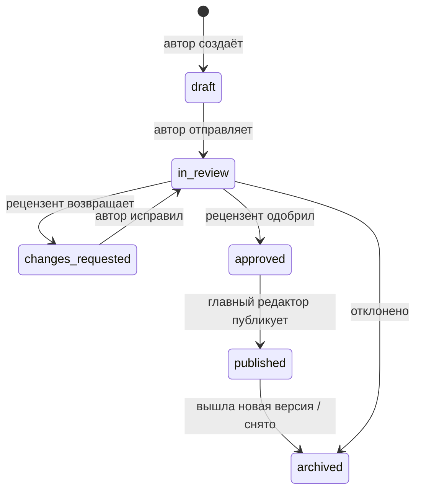

# 5. Образовательные модули, вузы и геймификация

## 5.1. Структура контента

```
Дисциплина (Хирургия)
└── Тема (Острый аппендицит)
    ├── Урок 1..n          — текст, таблицы, изображения, ссылки на МКБ-10 и КР
    ├── Тест темы          — фиксированный набор 10–15 вопросов
    └── Кейсы              — привязаны к дисциплине, ссылаются на темы
Справочники: МКБ-10 · Клинические рекомендации (с версиями)
```

Урок хранится как массив типизированных блоков (`jsonb`), а не HTML: мобильный клиент рендерит их нативными виджетами, контент безопасен (нет XSS) и одинаково выглядит в обеих темах. Блоки `icd_ref` и `guideline_ref` ссылаются на справочники и показывают актуальную версию КР с пометкой, если КР пересмотрена после публикации урока.

## 5.2. Редакционный процесс и медицинская проверка



Правила (проверяются в `content.services`, а не только в UI админки):

- Отправить на проверку можно только с указанным ≥ 1 источником и правом его использования.
- Рецензент ≠ автор; рецензент должен иметь роль `medical_reviewer` и указанную профильную дисциплину.
- Публикация новой ревизии атомарно архивирует предыдущую; пользователи с пройденным уроком не теряют прогресс.
- Каждое решение пишется в `content_reviews`; на карточке урока в приложении видны «Проверено: Иванов И. И., хирург, 12.10.2026» и дата обновления.
- Сообщение пользователя об ошибке (`feedback.kind = content_error`) создаёт задачу в админке с ссылкой на конкретную ревизию; исправление — новая ревизия с `change_summary`.
- **Клинические рекомендации:** раз в месяц Celery-задача сверяет `revision_due` и помечает КР «требует проверки»; ответственный редактор обновляет версию. Уроки и вопросы, ссылающиеся на пересмотренную КР, автоматически попадают в очередь перепроверки.
- **Права на материалы:** `sources.license` + документ о правах в S3; истекающие права (`rights_expires_at`) — напоминание за 30 дней. Иллюстрации — только собственные, лицензированные или с совместимой открытой лицензией.
- Новые дисциплины добавляются полностью через админку (дисциплина → темы → уроки), без релиза приложения.

## 5.3. Тесты

| Режим | Источник вопросов | Особенности |
|-------|------------------|-------------|
| Тест темы | фиксированный набор `quiz_questions` | основа для освоения темы |
| Тренировка | случайные N вопросов дисциплины, взвешенно по низкому освоению | бесконечная практика |
| Работа над ошибками | вопросы, на которые последний ответ был неверным | доступна после ≥ 5 ошибок |

Поток попытки:

1. `POST /quizzes/{id}/attempts` → сервер фиксирует набор вопросов (конкретные версии) и порядок вариантов; клиент получает вопросы **без** признаков правильности.
2. `POST /attempts/{id}/answers` на каждый вопрос (сервер считает время ответа).
3. `POST /attempts/{id}/finish` (с `Idempotency-Key`) → подсчёт, событие `QuizAttemptFinished` → освоение, XP, достижения.
4. `GET /attempts/{id}/review` → для каждого вопроса: выбранные варианты, правильные, объяснение **каждого** варианта (почему верно / почему нет), ссылка на урок и источник.

Незавершённая попытка старше 24 часов становится `abandoned`.

## 5.4. Клинические кейсы

Кейс — направленный граф шагов. Шаг `narrative` показывает данные (жалобы, анамнез, осмотр, результаты обследований — синтетические), шаг `decision` предлагает варианты действий. У каждого выбора: качество (`optimal / acceptable / wrong / dangerous`), баллы, обратная связь и следующий шаг. В MVP граф почти линейный (выбор влияет на баллы и обратную связь, ветвление — до 2 веток), чтобы контент было реально написать и проверить.

Итог кейса: набранный балл, оптимальный путь рядом с путём пользователя, ключевые ошибки, ссылки на уроки и КР. Обязательный дисклеймер: «Учебный кейс. Пациент вымышлен. Не является руководством к лечению».

Требования к синтетическим данным: без ФИО (только «Пациент М., 54 года»), без реальных дат, мест и редких сочетаний признаков, по которым можно узнать реального человека; рецензент подтверждает чекбоксом `synthetic_attested_by`.

## 5.5. Прогресс и аналитика знаний

- **Урок пройден** — пользователь долистал до конца и нажал «Завершить».
- **Освоение темы** `mastery` = доля верных ответов по последним 20 ответам на вопросы темы с весом сложности; 0–1. Тема «освоена» при ≥ 0,8 и ≥ 10 ответах.
- **Освоение дисциплины** — среднее освоение тем, взвешенное по числу вопросов.
- Экран «Аналитика знаний»: освоение по дисциплинам (столбцы), слабые темы, динамика верных ответов за неделю/месяц/год, время обучения. Расширенная аналитика (сравнение с курсом, прогноз) — кандидат в Premium.

## 5.6. XP, уровни, достижения, серии

| Действие | XP |
|----------|----|
| Урок пройден впервые | +20 |
| Верный ответ в тесте (первое прохождение теста) | +2 |
| Бонус за результат ≥ 80 % | +10 |
| Повтор теста | +2 за каждый верный ответ **сверх** лучшего прошлого результата |
| Кейс завершён | +30 × доля набранных баллов (0–30) |
| Серия дней (каждый день серии, начиная со 2-го) | +5 |
| Достижение | по `achievements.xp_reward` |
| Лимит | 500 XP в сутки (сверх — XP не начисляется, но прогресс сохраняется) |

**Уровень:** для перехода на уровень *L* нужно суммарно `50 · L · (L − 1)` XP (2 → 100, 3 → 300, 5 → 1 000, 10 → 4 500, 20 → 19 000). Уровень отражает учебную активность и не связан с образовательным статусом.

**Серия:** день засчитывается при ≥ 1 пройденном уроке, тесте или кейсе (по часовому поясу пользователя из устройства).

**Достижения MVP (≈ 15):** первый урок, первый тест, первый кейс, 100 % в тесте, 10/50/100 тестов, серия 3/7/30 дней, освоена первая тема, освоена дисциплина, 5 работ над ошибками, «Основатель» (первые 100 подтверждённых), участник рейтинга. Критерии описаны декларативно в `criteria` (`{"type": "count", "metric": "quizzes_finished", "gte": 10}`) и проверяются обработчиком событий.

## 5.7. Рейтинги

- **Участие добровольное** (`leaderboard_opt_in`, по умолчанию выключено); видны только никнейм, уровень и вуз (вуз — можно скрыть). Выход из рейтинга мгновенно убирает пользователя из таблиц.
- **Студенты:** по XP за период — неделя (пн–вс), месяц, всё время; области — «все пользователи» и «мой вуз». Пользователь всегда видит своё место, даже вне топ-50.
- **Вузы:** балл вуза = среднее XP за период на одного **активного участника** (≥ 1 XP за период, opt-in, подтверждённый email, `trust_status = ok`); вуз попадает в рейтинг при ≥ 5 таких участниках. Рядом показывается число участников. Так маленький вуз с активными студентами конкурирует с большим, а накрутка мультиаккаунтами невыгодна.
- **Реализация:** при начислении XP обновляются Redis sorted sets (`lb:users:week:2026-W44`, `lb:uni:{id}:week:…`); раз в 10 минут Celery пересчитывает рейтинг вузов; в конце периода — снимок в `leaderboard_snapshots`. XP вуза берётся из `xp_events.university_id` — при смене вуза прошлые очки остаются за прежним вузом.
- Флаг `leaderboards_enabled` позволяет скрыть рейтинги до появления достаточного числа участников (на старте пустые таблицы демотивируют).

## 5.8. Пользователи по вузам

- Справочник вузов заполняется заранее (государственные и частные медицинские вузы и медфакультеты РФ, ~100 записей) и ведётся в админке; поиск с учётом сокращений («Сеченовский», «ПМГМУ»).
- «Моего вуза нет» → `university_requests` → модерация: создать вуз, объединить с существующим или отклонить; после одобрения профиль пользователя обновляется автоматически.
- Специальности — по кодам ФГОС (31.05.01 Лечебное дело, 31.05.02 Педиатрия, 31.08.67 Хирургия и т. д.); для ординаторов список ординатурских специальностей.
- Смена статуса (студент → ординатор → врач) пишет историю; поля, не относящиеся к новому статусу, очищаются (у врача нет курса).
- **Подтверждение принадлежности (после MVP):** по вузовскому email-домену (`university_email_domains`, код на вузовскую почту) или вручную по документу с удалением файла после проверки. До подтверждения у вуза в профиле нет отметки «подтверждено», рейтинг вузов в будущем можно ограничить подтверждёнными.
